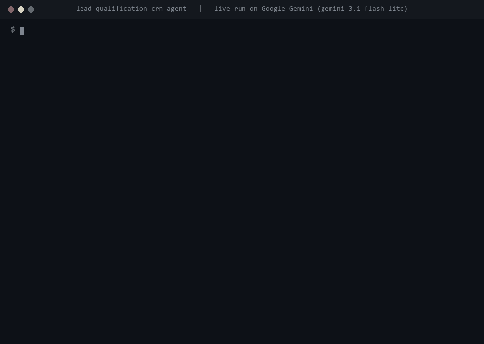

<h1>Lead Qualification Agent</h1>

<b>Scores every inbound lead against rules you define, pushes the qualified ones into HubSpot with a written reason, and sends the rest to a nurture list.</b>

  
  
  
  
  
  

  <a href="#what-it-does">What it does</a> &nbsp;|&nbsp;
  <a href="#how-it-works">How it works</a> &nbsp;|&nbsp;
  <a href="#sample-run">Sample run</a> &nbsp;|&nbsp;
  <a href="#quick-start">Quick start</a> &nbsp;|&nbsp;
  <a href="#configuration">Configuration</a> &nbsp;|&nbsp;
  <a href="#roadmap">Roadmap</a>

 

<h2>See it in action</h2>

Recorded from a real run on Google Gemini (<code>gemini-3.1-flash-lite</code>) on 12 November 2026. Nothing is edited or scripted. Only the waiting time while the model thinks is shortened. <a href="demo/demo.mp4">Download the MP4</a>.

<h2>The problem</h2>

Inbound forms bring in everyone: serious buyers, students, competitors and people who are just curious. Sales reps either waste hours on bad leads or skim and miss the good ones.

Simple form rules don't fix it, because two leads with the same budget and timeline can be completely different prospects. One wrote three specific sentences about their problem. The other wrote "just curious what you offer".

<h2>What it does</h2>

<table>
  <tr><th align="left">Capability</th><th align="left">What that means in practice</th></tr>
  <tr><td><b>Scoring with your rules</b></td><td>Budget, timeline, company size and a pass mark all live in <code>data/scoring_rubric.json</code>. A different client means a different file, not new code.</td></tr>
  <tr><td><b>Reads the message, not only the fields</b></td><td>The model weighs what the lead actually wrote and is told not to inflate scores to be nice.</td></tr>
  <tr><td><b>A reason with every score</b></td><td>Each lead gets a score out of 100, a written reason and a list of anything they left out.</td></tr>
  <tr><td><b>Pass or fail decided in code</b></td><td>Whether a lead is qualified is <code>score &gt;= qualify_threshold</code>, so the threshold you set is the only thing that decides what reaches a rep.</td></tr>
  <tr><td><b>HubSpot sync</b></td><td>Qualified leads are created as HubSpot contacts with the score and reason attached as a note. Existing contacts are updated, never duplicated.</td></tr>
  <tr><td><b>Nurture list</b></td><td>Everyone else lands in <code>output/nurture_list.csv</code> for marketing follow-up.</td></tr>
</table>

<h2>How it works</h2>

<pre>
lead (form fields + message) --&gt; model scores against the rubric
                                         |
                       score &gt;= threshold?  (decided in code)
                          |                     |
                         yes                    no
                          |                     |
          HubSpot contact + note,          nurture list
          optional Slack ping
</pre>

The model returns a Pydantic object with the score, the reason and the missing information. The score is clamped to 0 to 100, and the qualify decision is made in Python from your rubric.

Without a HubSpot token, qualified leads go to <code>output/crm_leads.csv</code> instead. Running the batch again updates leads that are already there rather than adding them twice.

<h2>Decisions I made on purpose</h2>

<h3>The rubric is the product</h3>

Getting the definition of a good lead out of the code was the point. Hardcoding one company's idea of qualified means rebuilding the project for the next client. Here you hand them a file and they tell you what a good lead looks like.

<h3>Works with a standard HubSpot account</h3>

Name, email and company are standard HubSpot fields. The score and reasoning are not, so they go on the contact's timeline as a note. That means it works on day one without the client creating custom properties first.

<h2>Sample run</h2>

<pre>
$ python process_leads.py
Scoring 5 leads against qualify_threshold=60

Rachel Kim (Horizon Fitness): 88/100, qualified=True
  Strong budget, immediate timeline, specific automation need in the message.
  -&gt; saved to crm_leads.csv (mock CRM)

Jordan Blake (Blake Consulting): 22/100, qualified=False
  No real budget, timeline is "not sure yet", message is vague curiosity
  rather than a project.

Done. 3 qualified, 2 sent to nurture list.
</pre>

<h2>Quick start</h2>

You need Python 3.12 or newer and an API key from OpenAI, Anthropic or Google Gemini.

<pre>
pip install -r requirements.txt
cp .env.example .env        # on Windows: copy .env.example .env
# open .env and paste your API key
python process_leads.py
</pre>

<h2>Configuration</h2>

Everything is set in <code>.env</code>. Copy <code>.env.example</code> to start.

<table>
  <tr><th align="left">Variable</th><th align="left">Required</th><th align="left">Purpose</th></tr>
  <tr><td><code>LLM_MODEL</code></td><td>Yes</td><td>Which model to use, as <code>provider:model</code>. Default <code>openai:gpt-5.5</code>. Also works with <code>anthropic:claude-opus-5-5</code> or <code>google_genai:gemini-3.5-flash</code>.</td></tr>
  <tr><td><code>OPENAI_API_KEY / ANTHROPIC_API_KEY / GOOGLE_API_KEY</code></td><td>One of them</td><td>The key for whichever provider you picked.</td></tr>
  <tr><td><code>HUBSPOT_ACCESS_TOKEN</code></td><td>No</td><td>HubSpot private app token with the <code>crm.objects.contacts.read</code> and <code>crm.objects.contacts.write</code> scopes.</td></tr>
  <tr><td><code>SLACK_WEBHOOK_URL</code></td><td>No</td><td>Posts a message to Slack for every qualified lead.</td></tr>
</table>

<h2>Project structure</h2>

<pre>
lead-qualification-crm-agent/
  .env.example             # copy to .env and add your key
  case_study.md            # longer write-up of the design
  process_leads.py         # scores the batch and routes each lead
  README.md
  requirements.txt         # dependencies
  agent/
    crm_client.py          # HubSpot contacts and notes, with the CSV fallback
    llm.py                 # picks the model from LLM_MODEL
    scoring.py             # the scoring prompt and the qualify rule
  data/
    leads.csv              # five sample leads
    scoring_rubric.json    # your definition of a qualified lead
  demo/                    # recording of a live run (GIF and MP4)
  tests/                   # pytest suite, runs without any API key
</pre>

<h2>Built with</h2>

Python &nbsp;&middot;&nbsp; LangChain &nbsp;&middot;&nbsp; Pydantic &nbsp;&middot;&nbsp; HubSpot API &nbsp;&middot;&nbsp; Slack &nbsp;&middot;&nbsp; OpenAI / Anthropic / Gemini

<h2>Tests</h2>

<pre>
pip install -r requirements-dev.txt
pytest
</pre>

Five tests cover the threshold rule, score clamping, the local CRM file not duplicating leads, and the HubSpot calls against a stand-in for the API. None of the tests call a model or need an API key, so they run on GitHub Actions on every push. The badge at the top shows the latest result.

<h2>Roadmap</h2>

What I would build next if a client took this into production:

<ul>
  <li>A webhook so leads are scored the moment a form is submitted</li>
  <li>An automatic clarifying email when a lead leaves out key information</li>
  <li>Salesforce, Pipedrive and Airtable alongside HubSpot</li>
</ul>

<h2>More from this series</h2>

Nine production-minded AI agents, each solving one business problem properly.

<table>
  <tr><td><a href="https://github.com/saqib-n/ai-research-report-agent"><b>Research Report Agent</b></a></td><td>Researches a topic, notices its own gaps, and writes a report with a source for every claim.</td></tr>
  <tr><td><a href="https://github.com/saqib-n/ai-sales-outreach-agent"><b>AI Sales Outreach Agent</b></a></td><td>Personalised cold emails and follow-ups, with a human approving every send.</td></tr>
  <tr><td><a href="https://github.com/saqib-n/ecommerce-automation-agent"><b>E-commerce Order and Inventory Agent</b></a></td><td>Shopify order, stock and returns assistant, plus a monitor that warns you before stock runs out.</td></tr>
  <tr><td><a href="https://github.com/saqib-n/email-triage-agent"><b>Email Triage Agent</b></a></td><td>Sorts an inbox into four buckets and gives each one a different level of autonomy.</td></tr>
  <tr><td><a href="https://github.com/saqib-n/multi-agent-customer-support"><b>Multi-Agent Customer Support</b></a></td><td>A router plus specialist agents for orders, refunds, FAQs and human handoff.</td></tr>
  <tr><td><a href="https://github.com/saqib-n/rag-knowledge-base-agent"><b>RAG Knowledge Base Agent</b></a></td><td>Answers questions from your own documents and names the source for every answer.</td></tr>
  <tr><td><a href="https://github.com/saqib-n/recruiting-screening-agent"><b>Resume Screening Agent</b></a></td><td>Ranks resumes against a job description with evidence, and guards against common bias.</td></tr>
  <tr><td><a href="https://github.com/saqib-n/whatsapp-support-agent"><b>WhatsApp Support Agent</b></a></td><td>A WhatsApp Cloud API agent that checks orders, answers FAQs and escalates to a person.</td></tr>
</table>

<h2>Work with me</h2>

I'm Saqib Nawaz, founder of WolfXense AI. I build AI agents and automations for businesses, with Python, LangChain, LangGraph and n8n, and connect them to the tools teams already use, like CRMs, Shopify, Slack, email and WhatsApp.

If your reps are drowning in unqualified leads, I can tune this to your own criteria and connect it to your forms and your CRM.

<a href="https://www.upwork.com/freelancers/~01de008504a38baf28"><b>Hire me on Upwork</b></a> &nbsp;|&nbsp; <a href="https://github.com/saqib-n"><b>More of my work on GitHub</b></a>

Released under the <a href="LICENSE">MIT License</a>. A longer write-up of the design is in <a href="case_study.md">case_study.md</a>.

